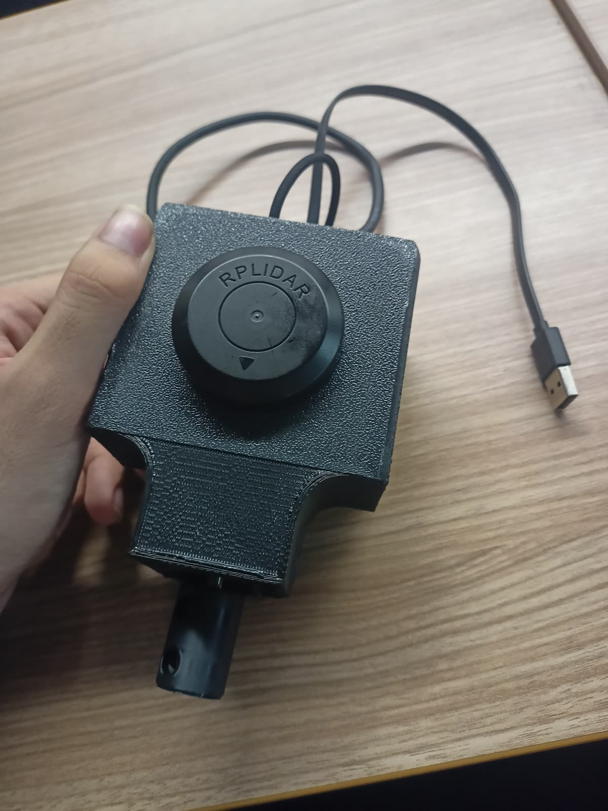
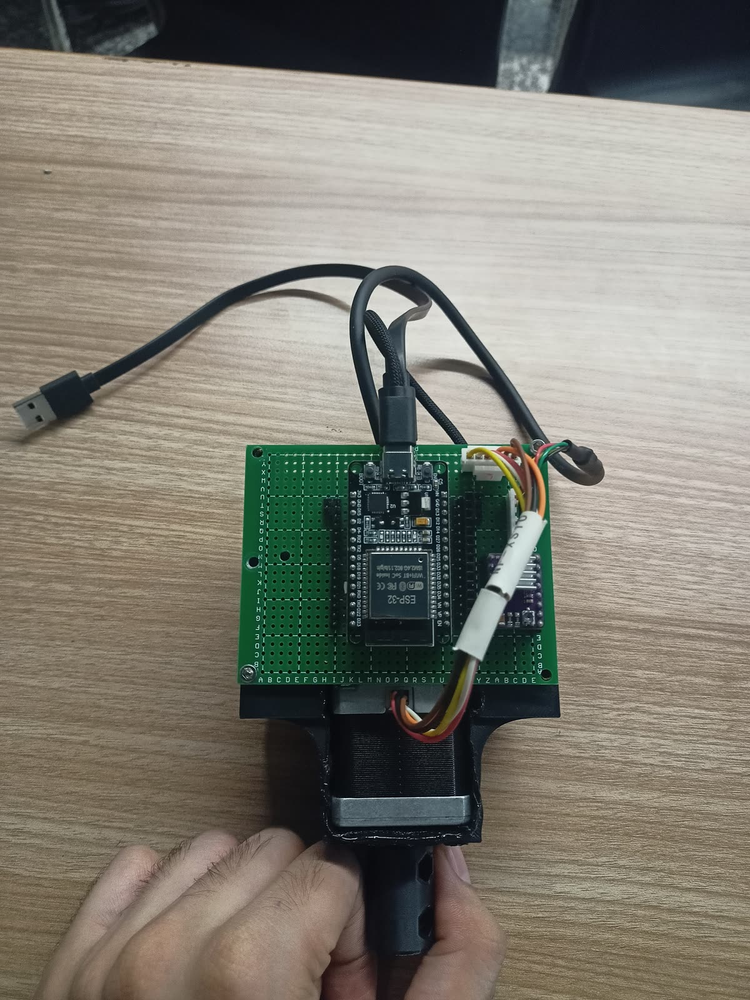
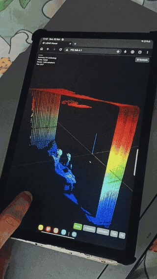
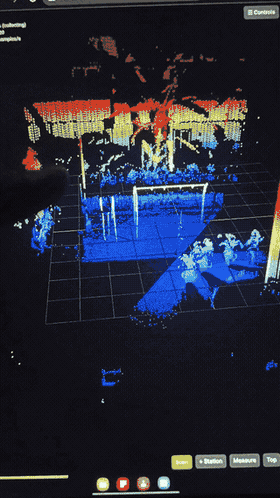
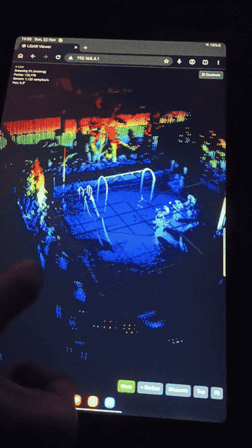
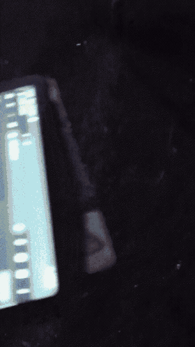

# DIY 2.5D LiDAR Mapper

A compact, portable 3D scanning rig built by rotating a 2D LiDAR (RPLidar C1) on a servo/stepper-driven pan axis, producing 3D point clouds from a sensor that natively scans in 2D. Designed to be lightweight and easy to carry for handheld or tripod-mounted field scans, the system operates in both wired and wireless (WiFi) modes over ROS2.

| Front View | Back View |
| :---: | :---: |
|  |  |

---

## Scan Demos & Web Interface

### Indoor & Outdoor 3D Point Clouds

| Indoor Mapping | Outdoor Mapping | Complete Outdoor Scan |
| :---: | :---: | :---: |
|  |  |  |

### Live Web Control Panel



---

## Quick Start

For a full list of terminal commands, launch flags, and debugging steps, refer to [`commands.md`](commands.md).

### 1. Hardware

- **RPLidar C1 (Slamtec)** — 2D LiDAR, approximately 55.6 × 55.6 × 41.3 mm, UART interface (3.3V TTL), 460800 baud.
- **ESP32** (standard development board, e.g., ESP32-DevKitC or ESP32-S3) — Reads the LiDAR over UART, drives the pan motor, and hosts WiFi and the web control panel.
- **Pan Actuator** — Either:
  - A hobby servo (e.g., MG996R) connected to a PWM pin — simple implementation, limited to approximately 0–180°.
  - A NEMA17 stepper motor with a DRV8825 driver — full-range rotation and smoother motion, requiring current-limit (`Vref`) tuning.
- **Power & Portability** — The RPLidar C1 requires a stable 5V supply (approximately 230 mA typical), ideally isolated from the logic supply. For portable field scanning, a dedicated 5V/2A+ USB power bank or battery pack with a buck/boost converter is recommended to prevent brownouts during WiFi and stepper current spikes.

#### Wiring (Direct UART, No USB Adapter Board)

| RPLidar C1 Pin | ESP32 Pin |
| :--- | :--- |
| TX | Any UART RX-capable GPIO |
| RX | Any UART TX-capable GPIO |
| 5V | 5V supply |
| GND | Common GND |

**Note:** UART connections must be crossed: LiDAR TX → ESP32 RX and LiDAR RX → ESP32 TX.

A standard ESP32 provides three hardware UARTs (UART0/1/2). `HardwareSerial(2)` is assigned to the LiDAR, leaving UART0 available for USB flashing and serial debugging.

### 2. Flash the ESP32

The firmware can be uploaded using either **PlatformIO** or the **Arduino IDE**.

**PlatformIO (Recommended)**

Open the following project directory:

```bash
lidar_mapper_ros2/esp_code/platformio_esp_code/lidar-stepper-esp32
```

Alternatively, use the updated firmware available in `v2/`.

Configure your WiFi credentials and pin mappings, then upload:

```bash
pio run --target upload
```

**Arduino IDE**

Open the following sketch:

```text
lidar_mapper_ros2/esp_code/esp32_wireless_lidar_stepper/esp32_wireless_lidar_stepper.ino
```

Configure your WiFi SSID, password, and STEP/DIR pin numbers, then compile and upload the firmware.

On boot, the ESP32 Serial Monitor displays its IP address and the URL of the web control panel.

### 3. Build and Run the ROS2 Package

**Requirements:** ROS2 Humble on Ubuntu 22.04.

Dependencies and workspace compilation are automated through the installation script:

```bash
chmod +x install.sh
./install.sh
```

In each new terminal session, source the ROS2 workspace:

```bash
source ros2_ws/install/setup.bash
# For Zsh:
source ros2_ws/install/setup.zsh
```

Launch the mapper in wireless mode:

```bash
ros2 launch lidar_mapper_ros2 lidar_mapper.launch.py mode:=wireless
```

For wired mode (when the LiDAR USB adapter is connected directly to the host machine):

```bash
ros2 launch lidar_mapper_ros2 lidar_mapper.launch.py mode:=wired
```

### 4. Visualize the Point Cloud

Start RViz2:

```bash
rviz2
```

Add the following displays:

- **PointCloud2:** Subscribe to `/accumulated_map` to visualize the accumulated 3D point cloud.
- **LaserScan (Optional):** Subscribe to `/scan` to view the live vertical scan slice.

### 5. Control the Rig

Open the ESP32's IP address in a web browser on your laptop or phone to access the live control panel.

The interface allows you to:

- Manually jog the pan axis.
- Switch between manual and automatic sweep modes.
- Configure sweep start and end angles.
- Adjust angular step size.
- Control sweep speed in real time.

---

## How It Works

The RPLidar C1 spins internally in a **vertical plane** (mounted upright rather than in its native horizontal orientation).

The servo or stepper motor pans the assembly sideways in **azimuth**, sweeping the vertical scan plane across the environment.

Each LiDAR sample `(angle, distance)` is tagged with the pan axis angle at that instant and projected into 3D Cartesian coordinates:

```text
x = r * cos(theta) * cos(psi)
y = r * cos(theta) * sin(psi)
z = r * sin(theta)
```

Where:

- `r` = Measured LiDAR range.
- `theta` = LiDAR's internal scan angle.
- `psi` = Pan axis angle.

### ROS2 Processing Pipeline

On the ROS2 side, the system:

1. Publishes standard `/scan` messages using `sensor_msgs/LaserScan`.
2. Uses a URDF and `robot_state_publisher` to maintain the `base_link -> pan_link -> lidar_link` TF tree.
3. Applies the pan rotation automatically through TF.
4. Runs a `scan_accumulator_node` to merge successive sweeps into `/accumulated_map`.
5. On shutdown, processes the accumulated point cloud using Open3D:
   - Voxel downsampling.
   - Statistical outlier removal.
6. Exports the cleaned point cloud as `accumulated_map.npy`.

---

## Repository Structure

```text
2.5d-lidar/
├── assets/                                  # Hardware photos, web UI demo, and 3D scan GIFs
├── lidar_mapper_ros2/                       # V1 ROS2 package and ESP32 firmware
│   ├── esp_code/
│   │   ├── esp32_wireless_lidar_stepper/    # Arduino IDE stepper firmware
│   │   └── platformio_esp_code/             # PlatformIO project structure
│   └── pan_controller_node_wireless.py      # Wireless pan and telemetry node
├── v2/                                      # Version 2 firmware and upgraded system files
├── commands.md                              # Detailed CLI and ROS2 command reference
└── install.sh                               # Automated ROS2 dependency and build script
```

---

## Multi-Station 3D Mapping (Larger Spaces)

Since the scanner is portable, larger indoor or outdoor environments can be captured by relocating the rig across multiple scanning stations and registering the resulting point clouds.

Two approaches can be used:

### 1. Pure ICP Chain + Pose Graph Optimization

- Capture overlapping scans approximately 1–2 metres apart.
- Align adjacent point clouds using Iterative Closest Point (ICP).
- Perform global pose graph optimization.
- Incorporate loop closure to reduce accumulated alignment errors without requiring additional sensors.

### 2. VIO-Assisted Mapping

Mount a smartphone running ARKit-based pose streaming software (e.g., Record3DStream or TeleTool) to estimate the scanner's position.

- Record the scanner's pose at each station.
- Average the pose during the station's dwell period.
- Use the estimated poses to register and merge all station scans into a common global coordinate frame.

---

## Known Limitations & Lessons Learned

### 1. Motor Settling Time

Tagging points with the pan angle before the motor finishes moving and settling introduces smooth, systematic curvature in the point cloud. For example, straight walls may appear curved rather than exhibiting random measurement noise.

**Solution:** Separate the motor movement and settling delay from the data collection window.

### 2. Stepper Microstepping Configuration

The `MICROSTEP` value configured in the firmware must match the physical `MS1/MS2/MS3` jumper configuration on the DRV8825 driver.

A mismatch causes proportional scaling errors in azimuth angles, resulting in smooth geometric distortion.

### 3. WiFi Access Point Power Consumption

Hosting a SoftAP on the ESP32 draws noticeably higher peak current than connecting to an existing network using Station (STA) mode.

If brownout resets (`RTCWDT_BROWN_OUT_RESET`) occur during battery-powered operation:

- Use a higher-current 5V power supply.
- Alternatively, switch to STA mode using a phone hotspot.
- Configure a static IP or DHCP reservation if required.

### 4. RPLidar C1 Protocol Compatibility

Generic RPLidar libraries designed for the A-series may fail with the C1 due to descriptor length mismatches.

**Solution:** The ESP32 firmware implements the raw UART protocol directly to communicate with the RPLidar C1.

---

## Possible Extensions

- **Camera-LiDAR Colorization:** Project 3D LiDAR points onto camera frames using pinhole camera projection and a rigidly mounted camera.
- **Continuous 360° Rotation:** Integrate a slip ring to eliminate cable wind-up during continuous rotation.
- **Autonomous Ground Rover:** Reorient the LiDAR to its native horizontal scanning configuration and use it as a primary SLAM sensor with `slam_toolbox`.

---

## License

This project is licensed under the [MIT License](LICENSE).
